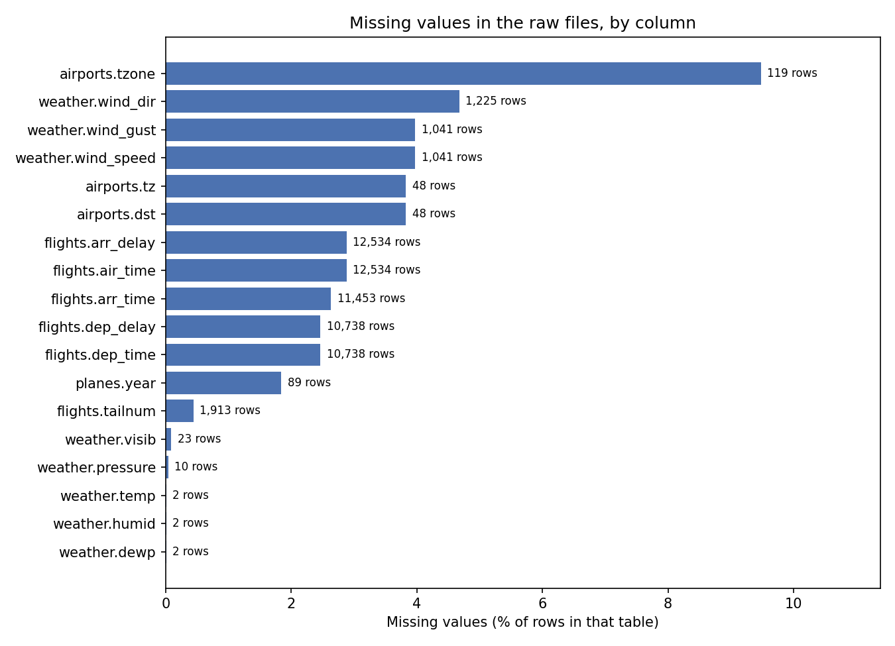
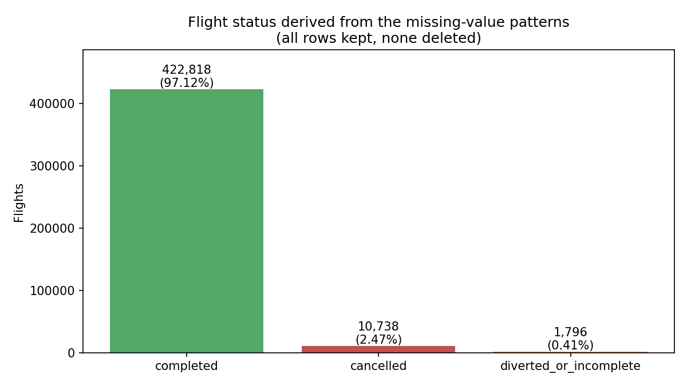
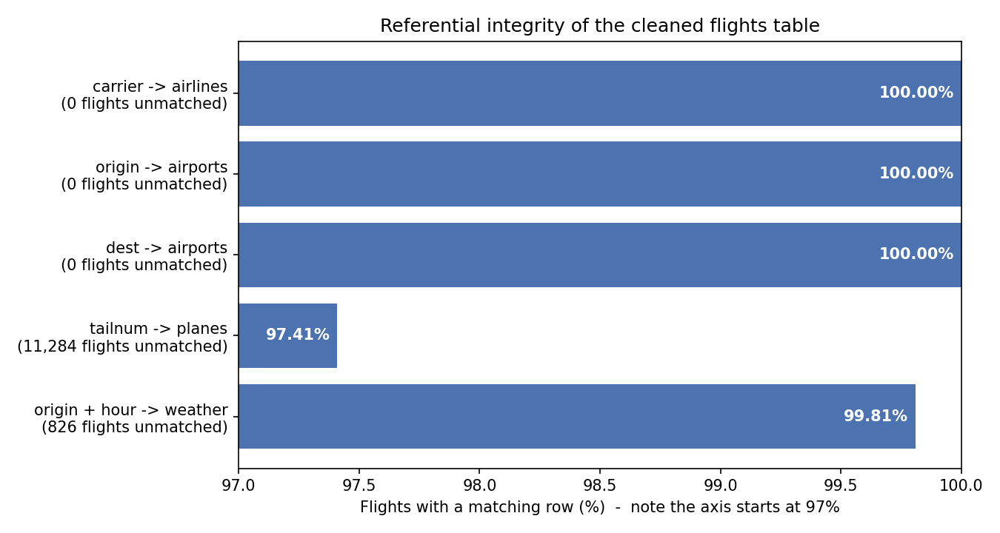
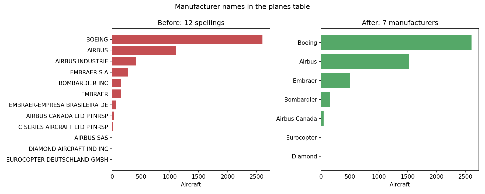

# NYC Flights 2023: a data-cleaning case study

**The problem.** A client hands over five raw exports (flights, airlines, airports, planes, weather) and needs a
trustworthy, database-ready dataset. This project audits the exports, records every problem with a decision,
cleans the tables and proves with automated checks that the result obeys the rules.

**The result.** All 435,352 flights were kept (no rows deleted, no values estimated). 47 issues were recorded in
a cleaning log. Clock times stored as numbers became real dates and times, cancelled and diverted flights are
flagged instead of hidden, and two tables that cannot be linked perfectly are documented with the exact number
of unmatched rows.

## The data

| Table | Rows | What it holds |
|---|---|---|
| flights | 435,352 | Every flight that left JFK, LGA or EWR in 2023 |
| airlines | 14 | Carrier code and name |
| airports | 1,255 | Airport code, name, coordinates, time zone |
| planes | 4,840 | Aircraft registry details |
| weather | 26,207 | Hourly weather at the three New York airports |

**Source.** The `nycflights23` data package v0.2.0 (https://github.com/moderndive/nycflights23), licence **CC0**
(public domain). It compiles US Department of Transportation Bureau of Transportation Statistics on-time data,
the FAA aircraft registry, airport metadata and NOAA/ASOS hourly weather. The files were exported to CSV
unchanged and are in `data/raw/`.

## Main issues and decisions

Every row below is measured in the notebook and listed in `data/processed/cleaning_log.csv`.

| Issue | Rows affected | Decision |
|---|---|---|
| Flights have no single-column key | 435,352 | Added `flight_id` |
| Clock times stored as HHMM numbers (517 = 05:17) | 435,352 | Converted to proper DATETIME and TIME columns |
| Midnight written as 2400 | 27 departures, 198 arrivals | Converted to 00:00 of the next day (departures) or 00:00:00 (arrivals) |
| Departure after midnight, but only the scheduled date is given | 2,409 | Used `dep_delay` to detect the day change and built the correct actual departure datetime |
| Missing delays on cancelled flights | 10,738 | Kept, left missing (not 0), flagged `cancelled` |
| Departed but no arrival delay or air time | 1,796 | Kept, left missing, flagged `diverted_or_incomplete` |
| Allegiant tail numbers missing the leading N (e.g. 203NV) | 668 | Added the N |
| Tail number not in the planes table | 9,371 (277 aircraft) | Kept; documented as an exception (use LEFT JOIN) |
| No weather row for the flight's hour | 826 | Kept; documented as an exception (use LEFT JOIN) |
| Planes: 12 manufacturer spellings for 7 makers | 4,840 | Standardised with an explicit mapping |
| Planes: `speed` is 0 on every row | 4,840 | Dropped |
| Airports: impossible or disguised values (`tz`, `dst`) | 2 + 1 + 21 | Set to missing, not guessed |
| Weather: `wind_gust` is exactly `wind_speed` x 1.15078 | 26,207 | Dropped (not a real measurement) |
| Weather: no data for 31 December (72 rows) and one hour at LGA | 73 airport-hours | Not invented; documented |
| Weather timestamps may be UTC, not local time | 26,207 | Not changed (cannot be confirmed); documented |
| Redundant or generic columns | several tables | Dropped or renamed with units |

## Before and after

| Measure | Before | After |
|---|---|---|
| Flights rows | 435,352 | 435,352 |
| Flights columns | 19 | 17 |
| Planes columns | 9 | 8 |
| Weather columns | 15 | 10 |
| Manufacturer spellings | 12 | 7 |
| Flights with a status label | 0 | 435,352 (422,818 completed, 10,738 cancelled, 1,796 diverted or incomplete) |
| Flights whose destination is in airports | 100% | 100% |
| Flights whose tail number is in planes | 97.4% (424,068 of 435,352) | unchanged; the gap is documented |
| Flights with a weather row | 99.8% (434,526 of 435,352) | unchanged; the gap is documented |
| Values imputed | n/a | 0 |

Share of flights that cancelled or did not record an arrival: 2.47% and 0.41%.









## Folder structure

```
nyc-flights-data-cleaning/
  README.md
  requirements.txt
  .gitignore
  notebooks/01_data_cleaning.ipynb   executed notebook: audit, cleaning, validation, export
  data/README.md                     data dictionary for every cleaned column
  data/raw/                          the five exports exactly as received (flights is zipped)
  data/processed/                    cleaned tables, flights_clean.zip, cleaning_log.csv
  images/                            charts used in this README
```

The cleaned files are UTF-8 CSVs with empty fields for missing values, ready to load into MySQL. The
dictionary in `data/README.md` suggests a MySQL type for each column.

## How to run (Windows and VSCode)

1. Install Python 3.10 or newer and VSCode with the Python and Jupyter extensions.
2. Open the project folder in VSCode and open a terminal.
3. Create an environment and install the packages:
   ```
   python -m venv .venv
   .venv\Scripts\activate
   pip install -r requirements.txt
   ```
4. Open `notebooks/01_data_cleaning.ipynb`, choose the `.venv` kernel and select Run All. It takes under a
   minute and uses relative paths only. It rewrites the files in `data/processed/`.

## Limitations

- Weather timestamps look about three to four hours late for New York local time. They were not shifted.
  Confirm the time zone before joining weather to flights.
- 9,371 flights (277 aircraft) have no plane details, so aircraft
  analysis covers only part of the data.
- Arrival times are clock times in the destination's time zone with no date. Use `air_time_min`, not
  arrival minus departure, for duration.
- Five plane records look wrong (a helicopter and a four-seat plane on airline flights, three A330 with 3
  engines) and `seats` is a registry reference figure. They were left unchanged and flagged.
- Two flights imply a speed above 700 mph and one arrival delay disagrees with its clock times. They were
  kept and documented.
- The classification of cancelled versus diverted flights is inferred from missing-value patterns. The source
  has no explicit cancellation flag.
- This is a cleaning project. It makes no claims about why flights were delayed.
